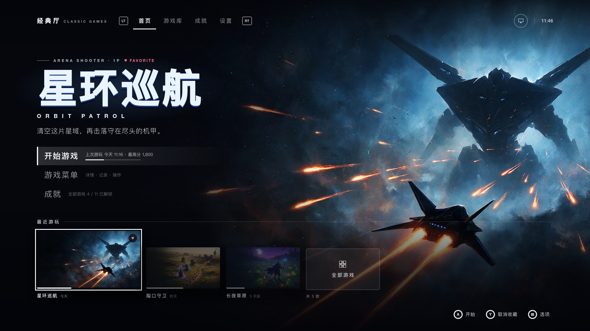
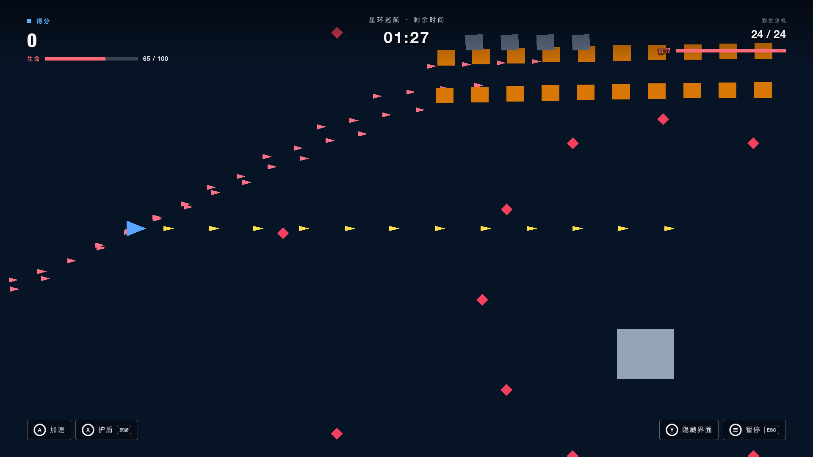
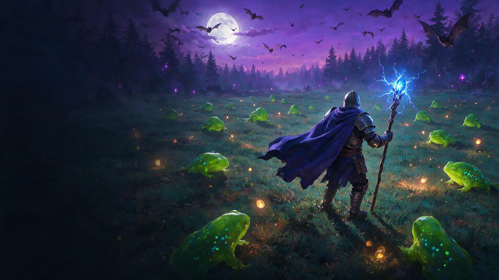
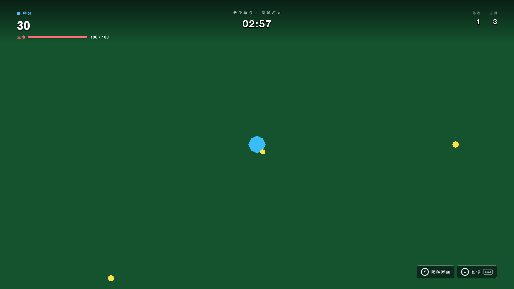
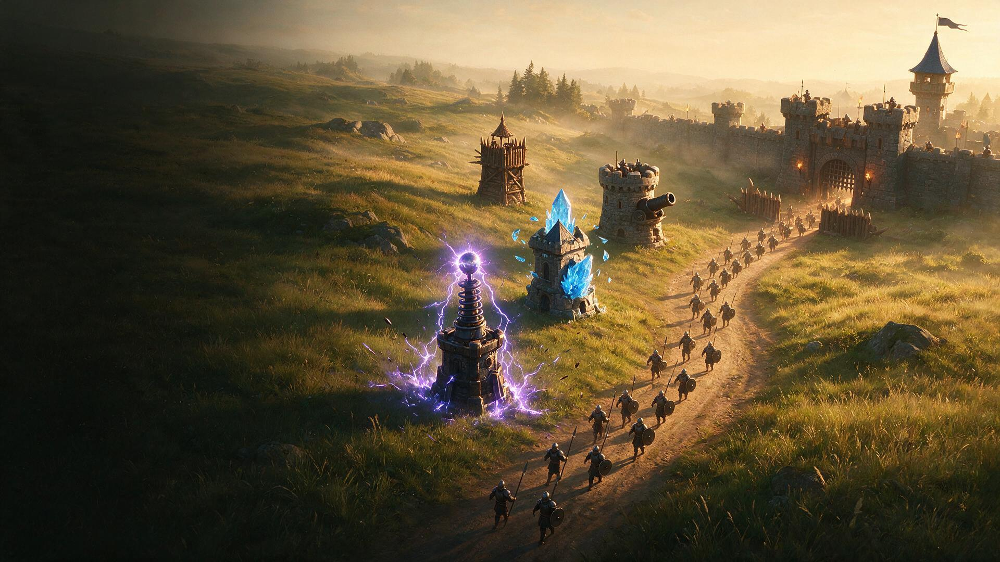
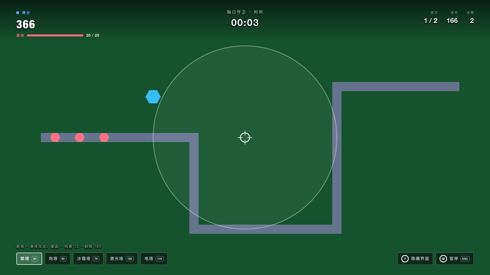
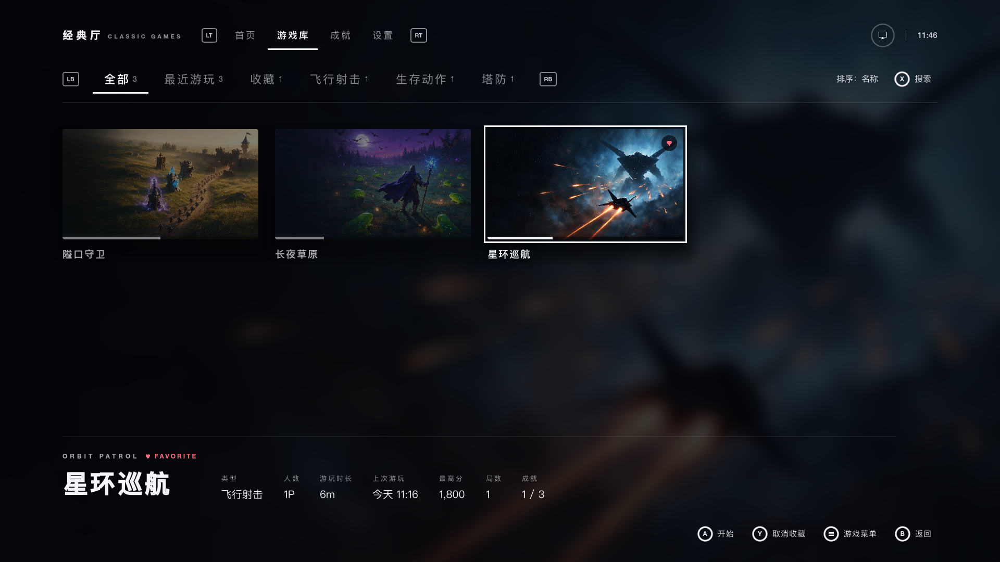
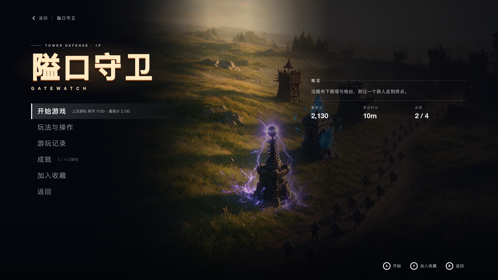
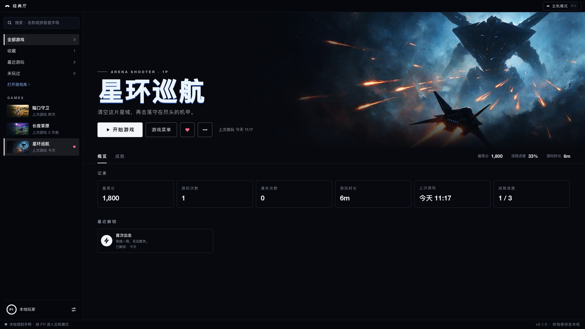
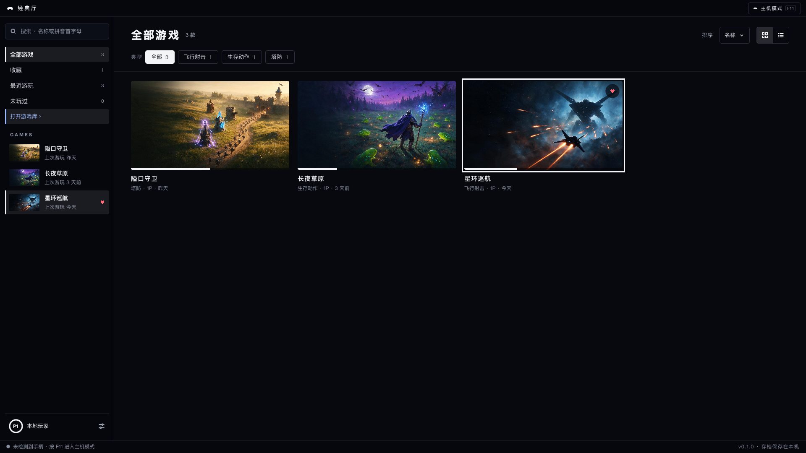

# Classic Games

[](./LICENSE)

English | [简体中文](./README.zh-CN.md)

Classic Games (经典厅) is an open-source console-style launcher with a collection of original games in classic genres. It is played with a gamepad or a keyboard, and it has a PC mode laid out for keyboard and mouse. All progress is stored locally; the launcher makes no network requests.

The project is pre-release. There are no published binaries, packages or store builds; everything below starts from source.



The screenshots in this file are unedited 1920×1080 captures of the launcher with the interface set to Chinese. English is the other built-in language.

## The games

Three games ship today. All three are original games made for this project.

| Game | Genre | How it plays |
|---|---|---|
| 星环巡航 / Orbit Patrol | Arena shooter | The weapon fires by itself; you fly. Destroy every enemy and the boss before the countdown ends. Holding boost makes you faster and doubles the score of each kill, and a shield absorbs one hit and then recharges. |
| 长夜草原 / Meadow Vigil | Survival action | The weapon attacks by itself; you move. Collect the orbs enemies drop to level up, and survive until the countdown ends. |
| 隘口守卫 / Gatewatch | Tower defense | Enemies walk a road toward the base. Spend gold to place five kinds of towers, earn gold back for each enemy defeated, and stop every wave. |

Each game is single-player and has its own achievements, 11 in total.

| Key art (illustration) | In game |
|---|---|
|  |  |
|  |  |
|  |  |

In-game graphics are plain geometric shapes for now; there is no sprite art yet. The key art is an illustration and does not represent how the games look. The three key art images were generated by this project with an image model, as original compositions; their provenance is recorded in [docs/legal/licenses.md](./docs/legal/licenses.md).

## The launcher

The launcher is a fixed 1920×1080 canvas that scales with the window. It lives in [`apps/client/launcher`](./apps/client/launcher) and is described in [section 8 of the client architecture](./docs/16-client-architecture.md).

- **Home**: the selected game with its key art, and a shelf of recently played games.
- **Library**: categories for all games, recently played, favourites and each genre; sorting; search by pinyin initials or by English name.
- **Achievements**: the achievements the game catalog defines, with their real unlock times. There are no rarity figures and no leaderboards.
- **Settings**: language (Chinese or English), window mode, vertical sync, frame rate cap, volume, keyboard rebinding, and exporting, importing or clearing the save.
- **Game menu, HUD, pause and result**: each game has its own menu with its rules, controls, records and achievements. In a run the launcher draws the HUD, pauses when the window loses focus, and records every run exactly once.
- **PC mode**: a second layout over the same data, with a sidebar, a search field, a grid or a list and genre filters. F11, or holding the View button on a gamepad, switches between the two modes. The switch is refused while a run is in progress.

Everything a screen says about the player (play time, best score, favourites, achievements) is read from one local save file, and a screen with no records shows an empty state.

| Library | Game menu |
|---|---|
|  |  |

| PC mode: game page | PC mode: library |
|---|---|
|  |  |

## Controls

Default bindings of the launcher interface, as defined in [`apps/client/project.godot`](./apps/client/project.godot). Gamepad glyphs use the A / B / X / Y layout.

| Action | Keyboard | Gamepad |
|---|---|---|
| Move the focus | Arrow keys | D-pad or left stick |
| Confirm | Enter, Space | A |
| Back | Esc, Backspace | B |
| Extra actions of the current screen (search, favourite) | X, Y | X, Y |
| Switch tabs inside a screen | Q, E | LB, RB |
| Switch top-level tabs | Page Up, Page Down | LT, RT |
| Options or game menu | M | Menu |
| Switch console mode and PC mode | F11 | Hold View |

Keyboard keys can be changed under Settings → Controls; gamepad buttons are fixed. In-game controls differ per game and are listed in each game's menu and on the pause screen. PC mode adds mouse control: click to select, double-click to start, right-click for the game's menu.

## Run it

Requirements: Godot 4.6.3 exactly (the standard build, not the .NET build; the version is pinned in [`apps/client/.godot-version`](./apps/client/.godot-version)) and GNU Make. Running the launcher and the games needs neither Go nor Node.js.

```bash
git clone https://github.com/yldm-tech/classic-games.git
cd classic-games
make import GODOT=/path/to/godot      # import resources once
/path/to/godot --path apps/client     # start the launcher
```

Or open `apps/client` in the Godot 4.6.3 editor and run the project. `make help` lists every target.

## Repository layout

| Path | What it is |
|---|---|
| [`apps/client`](./apps/client) | The Godot 4.6 project: the launcher in `launcher/` and the game runtimes in `runtime/`. See [client architecture](./docs/16-client-architecture.md). |
| [`apps/server`](./apps/server) | Go backend (gin, GORM) of the optional online service, module `github.com/yldm-tech/classic-games/apps/server`. See its [README](./apps/server/README.md). |
| [`apps/cli`](./apps/cli) | `classic-games`, a Go command-line tool (cobra), module `github.com/yldm-tech/classic-games/apps/cli`: offline DSL validation, patching and migration, and a client for the backend. See its [README](./apps/cli/README.md). |
| [`apps/mcp`](./apps/mcp) | `classic-games-mcp`, a Model Context Protocol server built on the official Go SDK, module `github.com/yldm-tech/classic-games/apps/mcp`: the same capabilities as tools for AI agents. See its [README](./apps/mcp/README.md). |
| [`apps/web`](./apps/web) | The website: landing page and documentation site (Astro and Starlight, pnpm). See its [README](./apps/web/README.md). |
| [`packages/schemas`](./packages/schemas) | The Mod DSL JSON Schemas, one file per runtime and version. |
| [`packages/dsl`](./packages/dsl) | Go module `github.com/yldm-tech/classic-games/packages/dsl`: RFC 6902 patch, DSL migration and schema validation, shared by the backend, the CLI and the MCP server. See its [README](./packages/dsl/README.md). |
| [`packages/sdk`](./packages/sdk) | Go module `github.com/yldm-tech/classic-games/packages/sdk`: typed HTTP client for the backend API, shared by the CLI and the MCP server. See its [README](./packages/sdk/README.md). |
| [`docs`](./docs) | Technical documentation, in Chinese. Start at [docs/README.md](./docs/README.md). |
| [`scripts`](./scripts) | Repository gates and helper scripts. |

Dependencies point one way, from `apps` to `packages`. The Go modules are tied together by [`go.work`](./go.work) and also reference each other with a relative `replace`, so each module builds on its own with `GOWORK=off`. The module paths are local to this repository and are not published to a module proxy. The reasons for this layout are recorded in [ADR-015](./docs/decisions.md).

## Games as data: the Mod DSL

Each game is a runtime under [`apps/client/runtime`](./apps/client/runtime), and what a runtime plays is described by a JSON document, the **Mod DSL**: enemies, waves, towers, stage parameters and so on. The launcher runs the baseline document that ships with each runtime (`baseline.dsl.json`). The schemas are in [`packages/schemas`](./packages/schemas); three runtimes exist today, `shooter`, `survivor` and `tower_defense`. The design is described in [docs/05-dsl-design.md](./docs/05-dsl-design.md).

Changes to a document are RFC 6902 (JSON Patch) patches, and collections that gain and lose elements are maps keyed by a stable id, not arrays ([ADR-013](./docs/decisions.md)). The launcher uses this itself: a start option such as Orbit Patrol's difficulty becomes one `replace` operation on the baseline. There are two implementations of the patch semantics, GDScript in [`apps/client/runtime/json_patch.gd`](./apps/client/runtime/json_patch.gd) and Go in [`packages/dsl`](./packages/dsl), and both are tested against the same baseline and the same golden output ([`apps/client/runtime/shooter/testdata/fork_expected.dsl.json`](./apps/client/runtime/shooter/testdata/fork_expected.dsl.json)). The supported operations are `add`, `replace`, `remove` and `test`; `move` and `copy` are rejected everywhere.

## The optional online service

The Go backend, the CLI, the MCP server and the SDK implement the Mod DSL (schema validation, RFC 6902 patches, migration, golden-file parity with the GDScript implementation) and the API of an online service: accounts, a game catalog, mods, community and commerce. They work and are covered by tests, but they are optional. The launcher is not wired to any of them and every game can be played without running them.

They need Go 1.26 (an older Go downloads the toolchain on demand).

```bash
make dev                              # backend on :8080; PORT=9090 make dev to change it
curl http://localhost:8080/healthz    # {"ok":true}
```

With no environment variables set, the backend runs in development mode on a SQLite file and uses a deterministic stub in place of a model, so it starts without any keys. Every variable is listed in [`.env.example`](./.env.example). The API reference is served at `http://localhost:8080/swagger/index.html` and described in [docs/09-api-design.md](./docs/09-api-design.md).

```bash
make cli-build                        # writes apps/cli/bin/classic-games
export PATH="$PWD/apps/cli/bin:$PATH"
classic-games dsl validate apps/client/runtime/shooter/baseline.dsl.json   # offline
classic-games server health           # needs the backend

make mcp-build                        # writes apps/mcp/bin/classic-games-mcp
```

The commands, the MCP client configuration and the security notes are in [`apps/cli/README.md`](./apps/cli/README.md) and [`apps/mcp/README.md`](./apps/mcp/README.md); the Go client is documented in [`packages/sdk/README.md`](./packages/sdk/README.md).

## Planned

More original games in classic genres are planned: base-defence tank action, a side-scrolling platformer, a co-op platformer, a maze bomb game, a co-op clear-the-screen arcade game and a run-and-gun. Each will have original names, characters, art and levels; none will recreate an existing commercial game. There are no dates.

## Development gates

All gates are `make` targets at the repository root.

```bash
make ci GODOT=/path/to/godot          # every Go and Godot gate
make ci-web                           # website: install, type check, build with link check
make ci-all GODOT=/path/to/godot      # both
```

`make ci` covers `gofmt`, `go mod tidy`, `go vet` and `go test` for all five Go modules, both in the workspace and with `GOWORK=off`, the CLI and MCP server builds, the architecture checks ([`scripts/check-architecture.sh`](./scripts/check-architecture.sh), [`scripts/check-client-boundaries.sh`](./scripts/check-client-boundaries.sh)) and the headless Godot suites. `make ci-web` needs Node.js 22.23.4 or newer and pnpm 12. Narrower targets exist for each area, for example `make launcher-test`, `make game-flow-test`, `make dsl-test` and `make test` (backend); [CONTRIBUTING.md](./CONTRIBUTING.md) lists them by area.

[`.github/workflows/ci.yml`](./.github/workflows/ci.yml) runs the same targets on pushes and pull requests to `main`.

## Documentation

- [docs/README.md](./docs/README.md) is the index of the technical documentation (Chinese).
- [docs/01-vision.md](./docs/01-vision.md) describes the product; [docs/16-client-architecture.md](./docs/16-client-architecture.md) describes the launcher and the runtime boundary.
- [docs/decisions.md](./docs/decisions.md) is the decision log (ADRs); [docs/glossary.md](./docs/glossary.md) is the glossary.
- The website in `apps/web` publishes the same documents next to the developer guides for the CLI, the MCP server and the Go SDK.

## Contributing

Contributions are welcome. [CONTRIBUTING.md](./CONTRIBUTING.md) covers the tools, the checks a change must pass, the architecture rules reviewers enforce and the rule that game content must be original. Participation is governed by the [Code of Conduct](./CODE_OF_CONDUCT.md). Notable changes are recorded in [CHANGELOG.md](./CHANGELOG.md).

## Security

Report suspected vulnerabilities privately, as described in [SECURITY.md](./SECURITY.md), not in a public issue.

## Licence

Classic Games is licensed under the [Apache License, Version 2.0](./LICENSE). Third-party attributions are in [NOTICE](./NOTICE) and [docs/legal/licenses.md](./docs/legal/licenses.md).
