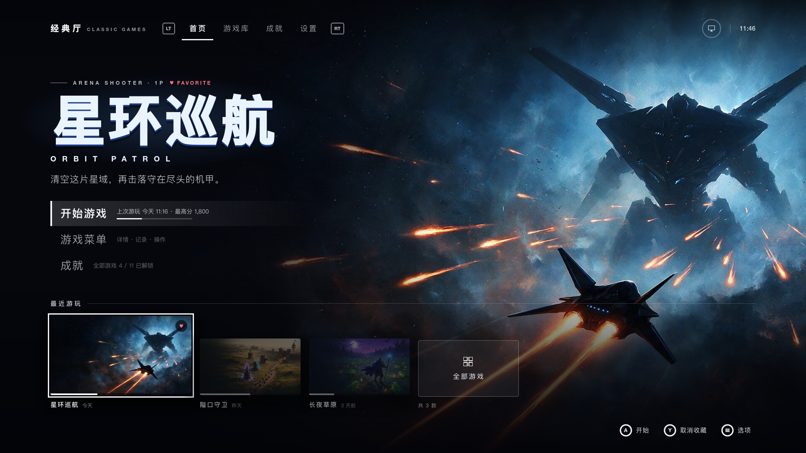
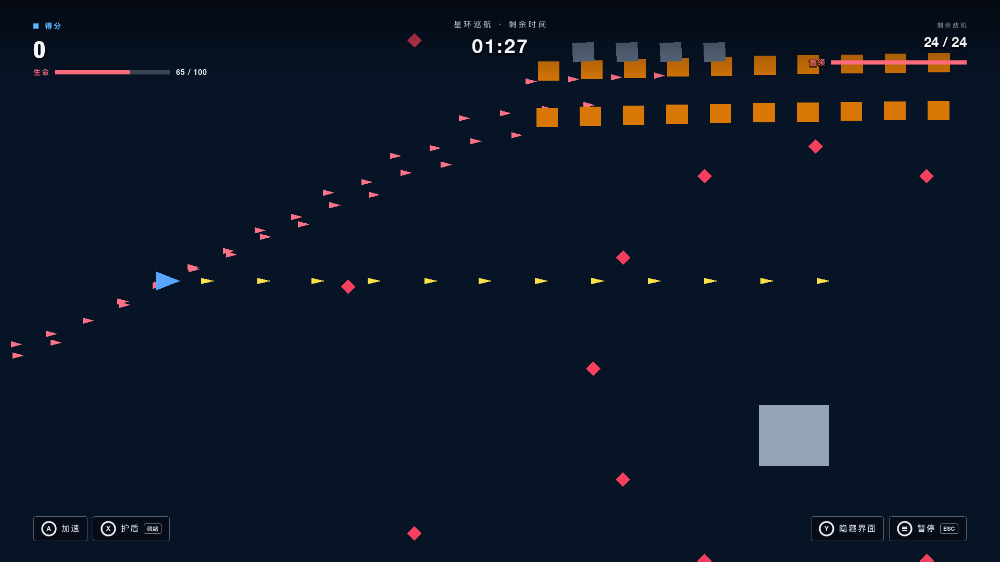
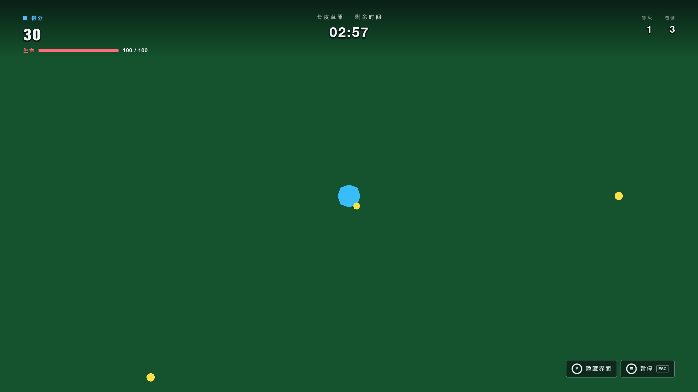
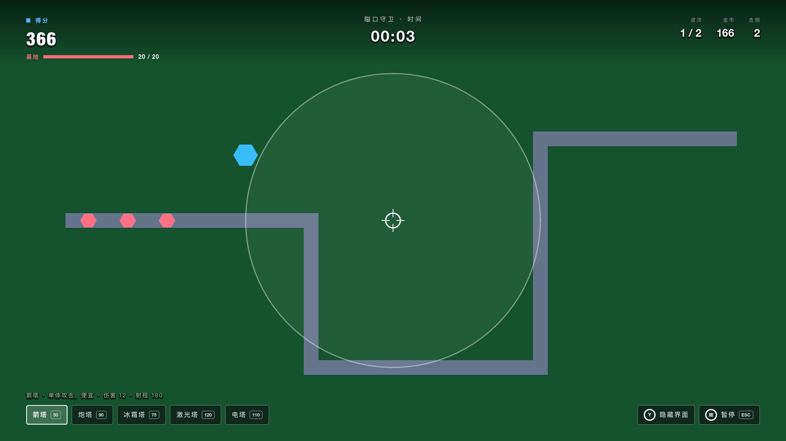
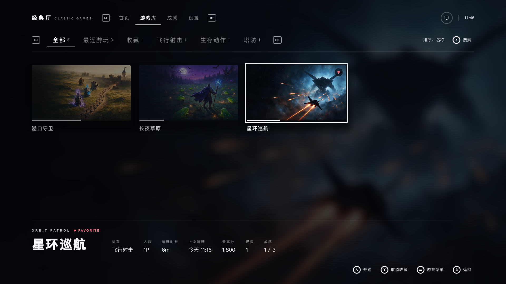
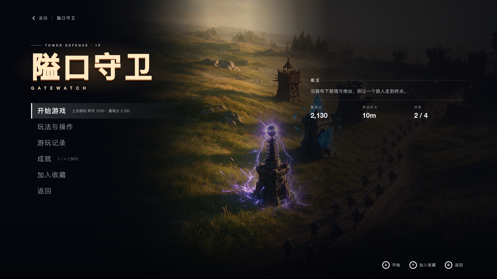
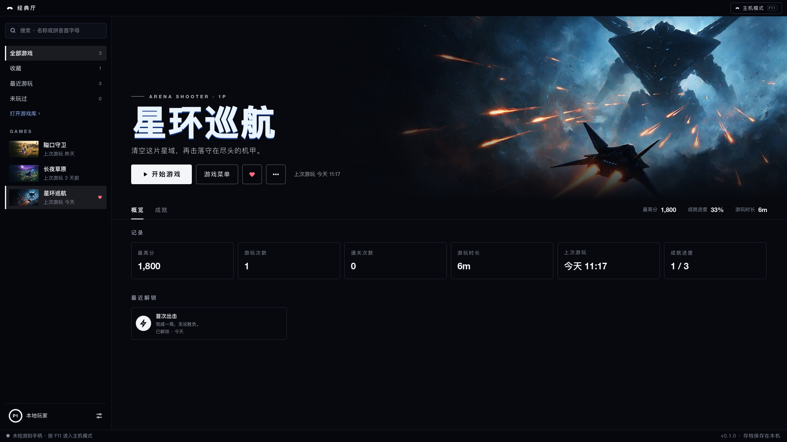
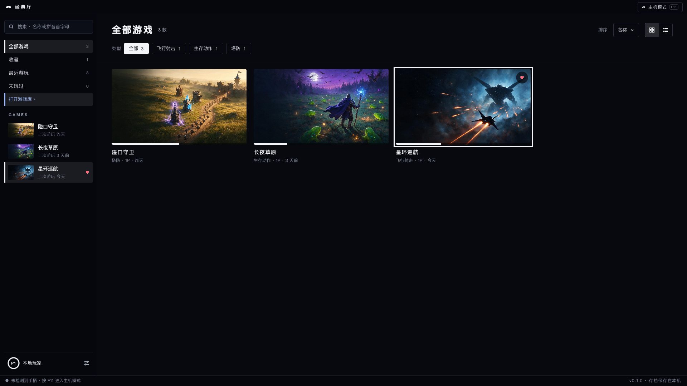

# Classic Games

[](./LICENSE)

[English](./README.md) | 简体中文

经典厅（Classic Games）是一个开源的主机风格游戏启动器，自带一组经典类型的原创游戏。用手柄或键盘游玩，另有面向键盘鼠标的 PC 模式。全部进度保存在本机，启动器不发任何网络请求。

项目尚未发布：没有公开的二进制、软件包或商店版本，下面的一切都从源码开始。



本文的截图都是启动器未经修饰的 1920×1080 画面，界面语言为中文；启动器另内置英文界面。

## 游戏

目前有三款游戏，都是为本项目制作的原创游戏。

| 游戏 | 类型 | 玩法 |
|---|---|---|
| 星环巡航 / Orbit Patrol | 飞行射击 | 武器自动开火，你只管走位。在倒计时结束前击落全部敌机和首领。按住加速时移动更快、击落得分翻倍；护盾抵消一次伤害，之后需要冷却。 |
| 长夜草原 / Meadow Vigil | 生存动作 | 武器自动攻击，你只管走位。拾取敌人掉落的经验球升级，撑到倒计时结束。 |
| 隘口守卫 / Gatewatch | 塔防 | 敌人沿道路走向基地。用金币放置五种防御塔，击倒敌人拿回金币，挡下全部波次。 |

每款游戏都是单人游戏，各有自己的成就，共 11 个。

| 主视觉（插画） | 局内画面 |
|---|---|
|  |  |
|  |  |
|  |  |

局内目前用的是纯几何图形，还没有贴图美术。主视觉是插画，不代表游戏的实际画面。三张主视觉由本项目用图像生成模型生成，是原创构图，来源记录在 [docs/legal/licenses.md](./docs/legal/licenses.md)。

## 启动器

启动器是固定 1920×1080 的画布，随窗口整体缩放。代码在 [`apps/client/launcher`](./apps/client/launcher)，说明见[客户端架构第 8 节](./docs/16-client-architecture.md)。

- **首页**：当前选中的游戏和它的主视觉，以及最近游玩的游戏。
- **游戏库**：按全部、最近游玩、收藏和类型分类，可以排序，可以按拼音首字母或英文名搜索。
- **成就**：只列出游戏目录里定义的成就和真实的解锁时间，没有稀有度，也没有排行榜。
- **设置**：语言（中文 / English）、窗口模式、垂直同步、帧率上限、音量、键盘改键，以及存档的导出、导入和清除。
- **游戏菜单、局内界面、暂停与结算**：每款游戏有自己的菜单，列出玩法、操作、游玩记录和成就。一局进行时由启动器绘制 HUD，窗口失去焦点时自动暂停，每一局恰好记录一次。
- **PC 模式**：同一份数据的另一种布局，有侧栏、搜索框、网格或列表、类型筛选。按 F11 或长按手柄的 View 键在两种模式之间切换；一局进行期间不能切换。

界面上关于玩家的一切（游玩时长、最高分、收藏、成就）都读自同一个本地存档文件，没有记录时显示空状态。

| 游戏库 | 游戏菜单 |
|---|---|
|  |  |

| PC 模式：游戏页 | PC 模式：游戏库 |
|---|---|
|  |  |

## 操作

启动器界面的默认按键，定义在 [`apps/client/project.godot`](./apps/client/project.godot)。手柄按键图标是 A / B / X / Y 布局。

| 操作 | 键盘 | 手柄 |
|---|---|---|
| 移动焦点 | 方向键 | 十字键或左摇杆 |
| 确认 | Enter、Space | A |
| 返回 | Esc、Backspace | B |
| 当前界面的附加操作（如搜索、收藏） | X、Y | X、Y |
| 切换页内标签 | Q、E | LB、RB |
| 切换顶层标签 | Page Up、Page Down | LT、RT |
| 选项或游戏菜单 | M | Menu |
| 切换主机模式与 PC 模式 | F11 | 长按 View |

键盘按键可以在「设置 → 控制」里修改，手柄按键是固定的。局内的操作每款游戏不同，列在各自的游戏菜单和暂停界面里。PC 模式另外支持鼠标：单击选中，双击开始，右键打开这款游戏的菜单。

## 运行

需要精确的 Godot 4.6.3（标准版，不要用 .NET 版；版本锁在 [`apps/client/.godot-version`](./apps/client/.godot-version)）和 GNU Make。只运行启动器和游戏不需要 Go，也不需要 Node.js。

```bash
git clone https://github.com/yldm-tech/classic-games.git
cd classic-games
make import GODOT=/path/to/godot      # 首次导入资源
/path/to/godot --path apps/client     # 启动启动器
```

也可以用 Godot 4.6.3 编辑器打开 `apps/client` 后运行工程。`make help` 列出全部目标。

## 仓库结构

| 路径 | 内容 |
|---|---|
| [`apps/client`](./apps/client) | Godot 4.6 工程：`launcher/` 是启动器，`runtime/` 是游戏运行时。见[客户端架构](./docs/16-client-architecture.md)。 |
| [`apps/server`](./apps/server) | 可选在线服务的 Go 后端（gin + GORM），模块 `github.com/yldm-tech/classic-games/apps/server`。见其 [README](./apps/server/README.md)。 |
| [`apps/cli`](./apps/cli) | 命令行工具 `classic-games`（cobra），模块 `github.com/yldm-tech/classic-games/apps/cli`：离线校验 DSL、应用补丁、做迁移，也可以访问后端。见其 [README](./apps/cli/README.md)。 |
| [`apps/mcp`](./apps/mcp) | MCP 服务 `classic-games-mcp`（官方 Go SDK），模块 `github.com/yldm-tech/classic-games/apps/mcp`：把同样的能力作为工具交给 AI 助手。见其 [README](./apps/mcp/README.md)。 |
| [`apps/web`](./apps/web) | 官网：落地页与文档站（Astro + Starlight，pnpm）。见其 [README](./apps/web/README.md)。 |
| [`packages/schemas`](./packages/schemas) | Mod DSL 的 JSON Schema，每个运行时每个版本一个文件。 |
| [`packages/dsl`](./packages/dsl) | Go 模块 `github.com/yldm-tech/classic-games/packages/dsl`：RFC 6902 补丁、DSL 迁移、schema 校验，后端、CLI、MCP 共用。见其 [README](./packages/dsl/README.md)。 |
| [`packages/sdk`](./packages/sdk) | Go 模块 `github.com/yldm-tech/classic-games/packages/sdk`：后端 HTTP API 的类型化客户端，CLI、MCP 共用。见其 [README](./packages/sdk/README.md)。 |
| [`docs`](./docs) | 技术文档，中文。从 [docs/README.md](./docs/README.md) 进。 |
| [`scripts`](./scripts) | 仓库门禁与辅助脚本。 |

依赖只有一个方向：`apps` 依赖 `packages`。五个 Go 模块由 [`go.work`](./go.work) 组成 workspace，同时彼此用相对路径 `replace` 引用，所以每个模块在 `GOWORK=off` 下也能独立构建。这些模块路径只在本仓库内有效，没有发布到模块代理。这种布局的理由见 [ADR-015](./docs/decisions.md)。

## 游戏即数据：Mod DSL

每款游戏都是 [`apps/client/runtime`](./apps/client/runtime) 下的一个运行时，运行时玩什么由一份 JSON 文档描述，这就是 **Mod DSL**：敌人、波次、防御塔、关卡参数等。启动器运行的是每个运行时自带的基线文档（`baseline.dsl.json`）。schema 在 [`packages/schemas`](./packages/schemas)，目前有三个运行时：`shooter`、`survivor`、`tower_defense`。设计见 [docs/05-dsl-design.md](./docs/05-dsl-design.md)。

对文档的修改是 RFC 6902（JSON Patch）补丁，会增删元素的集合是以稳定 id 为 key 的 map，不是数组（[ADR-013](./docs/decisions.md)）。启动器自己也用到这一点：《星环巡航》的难度这类开局选项，就是基线上的一条 `replace` 操作。补丁语义有两份实现，GDScript 的 [`apps/client/runtime/json_patch.gd`](./apps/client/runtime/json_patch.gd) 和 Go 的 [`packages/dsl`](./packages/dsl)，两边的测试共用同一份基线和同一份 golden 输出（[`apps/client/runtime/shooter/testdata/fork_expected.dsl.json`](./apps/client/runtime/shooter/testdata/fork_expected.dsl.json)）。支持的操作是 `add`、`replace`、`remove`、`test`；`move` 与 `copy` 在两端都被拒绝。

## 可选的在线服务

Go 后端、CLI、MCP 服务和 SDK 实现了 Mod DSL（schema 校验、RFC 6902 补丁、迁移、与 GDScript 实现共用 golden 文件的一致性测试）和一套在线服务的 API：账号、游戏目录、Mod、社区与商业化。它们可以运行，有测试覆盖，但属于可选组件：启动器没有接入其中任何一个，不运行它们也能玩全部游戏。

它们需要 Go 1.26（较旧的 Go 会按需下载工具链）。

```bash
make dev                              # 后端监听 :8080，改端口用 PORT=9090 make dev
curl http://localhost:8080/healthz    # {"ok":true}
```

不设任何环境变量时，后端以开发模式运行，数据库是一个 SQLite 文件，模型由确定性的 stub 代替，所以不需要任何密钥就能启动。全部环境变量见 [`.env.example`](./.env.example)。接口文档在 `http://localhost:8080/swagger/index.html`，设计见 [docs/09-api-design.md](./docs/09-api-design.md)。

```bash
make cli-build                        # 产物在 apps/cli/bin/classic-games
export PATH="$PWD/apps/cli/bin:$PATH"
classic-games dsl validate apps/client/runtime/shooter/baseline.dsl.json   # 离线
classic-games server health           # 需要后端在运行

make mcp-build                        # 产物在 apps/mcp/bin/classic-games-mcp
```

命令说明、MCP 客户端配置与安全说明见 [`apps/cli/README.md`](./apps/cli/README.md) 和 [`apps/mcp/README.md`](./apps/mcp/README.md)，Go 客户端见 [`packages/sdk/README.md`](./packages/sdk/README.md)。

## 计划

计划加入更多经典类型的原创游戏：基地防御坦克、横版平台跳跃、合作平台跳跃、迷宫炸弹、合作清版街机、跑动射击。每一款都会使用原创的名称、角色、美术和关卡，不复刻任何现有商业游戏。没有日期。

## 本地开发与验证

所有门禁都是仓库根目录的 `make` 目标。

```bash
make ci GODOT=/path/to/godot          # Go 与 Godot 的全部门禁
make ci-web                           # 官网：安装、类型检查、构建与断链检查
make ci-all GODOT=/path/to/godot      # 两者都跑
```

`make ci` 覆盖五个 Go 模块的 `gofmt`、`go mod tidy`、`go vet`、`go test`（workspace 与 `GOWORK=off` 各一遍）、CLI 与 MCP 的编译、架构检查（[`scripts/check-architecture.sh`](./scripts/check-architecture.sh)、[`scripts/check-client-boundaries.sh`](./scripts/check-client-boundaries.sh)）和 Godot 无头测试。`make ci-web` 需要 Node.js 22.23.4 以上与 pnpm 12。各部分另有更窄的目标，例如 `make launcher-test`、`make game-flow-test`、`make dsl-test`、`make test`（后端），按领域的列表见 [CONTRIBUTING.md](./CONTRIBUTING.md)。

[`.github/workflows/ci.yml`](./.github/workflows/ci.yml) 在 push 和 PR 到 `main` 时运行同样的目标。

## 文档

- [docs/README.md](./docs/README.md) 是技术文档的索引。
- [docs/01-vision.md](./docs/01-vision.md) 说明产品定位，[docs/16-client-architecture.md](./docs/16-client-architecture.md) 说明启动器和运行时边界。
- [docs/decisions.md](./docs/decisions.md) 是决策记录（ADR），[docs/glossary.md](./docs/glossary.md) 是术语表。
- 官网（`apps/web`）发布同一套文档，另有 CLI、MCP 服务与 Go SDK 的开发者指南。

## 参与贡献

欢迎贡献。工具、提交前要过的检查、评审时坚持的架构规则，以及「游戏内容必须原创」的规则，见 [CONTRIBUTING.md](./CONTRIBUTING.md)（英文，含中文指引）。参与者须遵守[行为准则](./CODE_OF_CONDUCT.md)。变更记录见 [CHANGELOG.md](./CHANGELOG.md)。

## 安全

疑似漏洞请按 [SECURITY.md](./SECURITY.md) 私下报告，不要开公开 issue。

## 许可证

Classic Games 以 [Apache License 2.0](./LICENSE) 发布。第三方归属见 [NOTICE](./NOTICE) 与 [docs/legal/licenses.md](./docs/legal/licenses.md)。
